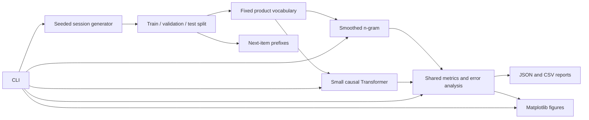

# Retail Basket Prediction Analyzer
[](https://msrit.ask.thili.ai/b/zzn5s2n8ds)
[](https://msrit.ask.thili.ai/b/q2mwv66mu5)
[](https://msrit.ask.thili.ai/b/69n55sw8x6)
[](https://msrit.ask.thili.ai/b/7uvv54pka3)


A reproducible experiment comparing a statistical n-gram model with a small causal Transformer for next-item prediction. Both learn from the same synthetic retail sessions; neither model uses pretrained weights or an external inference API.

## Stack

Python 3.10+, PyTorch, NumPy, Pandas, scikit-learn, Matplotlib, pytest, argparse, JSONL, CSV, and GitHub Actions. The models are small enough for CPU training; CUDA and MPS are optional.

## The question

If a simulated shopping session already contains a few products, how well can each model rank the next one? The project measures that on held-out sessions and compares results at several training-set sizes. It does not assume the neural model will win.

## What the data represents

The catalogue contains 57 products across dairy, bakery, beverages, fruit, vegetables, snacks, meat and alternatives, pantry, household, personal care, and frozen foods. A seeded generator creates sessions between two and eight products long. Ten planted templates represent common purchases such as bread, butter, and jam; pasta, sauce, and mozzarella; or burger buns, patties, and cheese. Other sessions use uniformly sampled independent or unusual combinations.

A basket has no natural order. Here, each record is a simulated shopping session: products from a planted template keep their written order, with optional random add-ons appended after the template. Independent and unusual sessions are randomly ordered. This gives the models a next-token target, but it is only a modelling convention. It is not evidence about real customer behavior or checkout timestamps.

The full transaction records are split into train, validation, and test partitions before any next-item prefixes are created. The product vocabulary comes from the fixed catalogue, not from test frequencies. The default seed is `1729`; rerunning generation with the same seed recreates the same sessions and splits.

## Models

### Statistical n-gram

`app/ngram.py` implements unigram through 4-gram counting without a language-model package. For a context `h` and next product `w`, each observed context order uses additive smoothing:

\[
P(w \mid h) = \frac{C(h,w)+\alpha}{C(h)+\alpha |V|}
\]

Here, `C` is a count, `α` is the smoothing value (default `0.2`), and `V` is the 57-product vocabulary. Available context distributions are interpolated, with each successively shorter context weighted by a factor of `0.55`; longer contexts receive more weight. If a context has never been observed, prediction backs off to shorter contexts and ultimately the unigram distribution. PAD and UNK are not recommendation targets.

### Causal Transformer

`app/transformer.py` builds a compact GPT-style model directly from PyTorch layers: token and position embeddings, masked multi-head self-attention, feed-forward layers, residual paths, layer normalization, and an output projection tied to the token embedding. The defaults are a 64-dimensional embedding, four attention heads, two blocks, a 12-token context, 10% dropout, and a `0.002` learning rate. `train-transformer` and `run-all` expose these settings as flags. It is initialized from scratch and trained with AdamW on shifted next-token targets. Padding and special tokens are excluded from the loss. CUDA and Apple Silicon MPS are detected when available; CPU is the default fallback.

## Architecture



## Install

Python 3.10 or newer is supported; Python 3.12 is a good default. From this folder:

```bash
python3.12 -m venv .venv
source .venv/bin/activate
pip install -r requirements-dev.txt
cp .env.example .env
```

The app runs locally and does not need credentials or a model download. `requirements.txt` contains runtime and test dependencies; `requirements-dev.txt` adds Ruff for the CI lint check.

## Run it

The quickest route generates data, trains both models, evaluates them, writes reports, and renders the plots:

```bash
python -m app.cli run-all --transactions 1200 --seed 1729 --epochs 6 --fractions 0.25 0.5 1.0 --device cpu
```

The saved split files are under `data/generated/`, model checkpoints and n-gram counts under `artifacts/`, and metrics and figures under `results/`. Model artifacts are local and ignored by Git; the small generated dataset and evaluation report are included in this project copy.

For separate steps:

```bash
python -m app.cli generate-data --transactions 1200 --seed 1729
python -m app.cli stats
python -m app.cli train-ngram --order 3 --alpha 0.2
python -m app.cli train-transformer --epochs 6 --batch-size 64 --device auto \
  --d-model 64 --n-heads 4 --n-layers 2 --block-size 12 --dropout 0.1 --learning-rate 0.002
python -m app.cli evaluate
python -m app.cli compare
python -m app.cli predict --basket "bread,butter" --top-k 5
python -m app.cli visualize
```

The catalogue accepts product names or IDs. To train on a subset in the separate model commands, pass `--fraction 0.5` to both trainers and use the same option for `evaluate` and `predict`.

Example from the checked-in run for `bread,butter`:

```text
N-gram:      snack_jam  0.6052
Transformer: snack_jam  0.9063
```

The probabilities are each model's distribution over the product catalogue; they are not calibrated purchase likelihoods.

## Evaluation

Every test session contributes one prediction for each product after the first. Both models see the same 702 prefixes, targets, vocabulary, and test sessions in the recorded run.

- **Top-k accuracy** is the share of targets ranked in the first `k` positions.
- **MRR** is the mean reciprocal rank, `mean(1 / rank_of_actual_item)`.
- **Mean rank** is the average position of the actual next product.
- **Cross-entropy** is the mean negative log probability assigned to the actual next product; lower is better.
- **Per-category accuracy**, **prefix-size accuracy**, and **per-template accuracy** break down top-1 behavior.

### Recorded run

These numbers were generated by the checked-in command above: 1,200 synthetic sessions, 840 train / 180 validation / 180 test, six Transformer epochs, one seed, and 702 next-item targets. This is a single reproducible run, not a multi-seed estimate. Python, PyTorch, NumPy versions, device, and model settings are recorded in the JSON report metadata.

| Metric (100% training data) | N-gram | Transformer |
|---|---:|---:|
| Top-1 accuracy | 0.2877 | 0.2877 |
| Top-3 accuracy | 0.3291 | 0.3177 |
| Top-5 accuracy | 0.3533 | 0.3248 |
| MRR | 0.3404 | 0.3316 |
| Mean rank | 20.4345 | 21.8148 |
| Cross-entropy | 3.2796 | 3.3628 |

The n-gram has the stronger top-3 and top-5 scores on this run; top-1 is tied. The Transformer improves as it sees more training sessions, but it does not surpass the n-gram here. At 25%, its top-1 accuracy is 0.0584; at 50%, 0.2251; and at 100%, 0.2877. The n-gram top-1 scores are 0.2949, 0.2963, and 0.2877 at those same sizes. `results/model_comparison.csv` contains all metrics by training size, while `results/metrics.json` contains category, template, rare-product, and representative error details. The dataset summary also records common pairs and two- or three-product itemsets.

The n-gram stores 1,238 observed context histories and 3,712 context-to-product outcomes across its orders in the full-data run. The Transformer has 104,640 trainable parameters. These are different kinds of complexity measures, so they should not be read as a direct resource-equivalence comparison.

Top-1 accuracy also changes with the amount of context already in the basket. In the full-data run, both models score 0.5751 on one- or two-product prefixes, 0.0127 on three- or four-product prefixes, and nearly zero at five or more. Most longer prefixes are already past the planted template and are followed by random add-ons, so the target is intentionally hard to infer. Among the planted templates, the snack-board sequence is relatively predictable (0.5909 n-gram, 0.6364 Transformer); unusual random combinations score zero for both. See the saved JSON for category-level figures.

### Figures from the recorded run


## Tests and code checks

```bash
ruff check app tests
pytest -q
```

The 34 tests cover seeded generation, session-level split isolation, JSONL round trips, vocabulary behavior, n-gram counts and smoothing, attention masking, checkpoint reloads, metric calculations, CLI failures and commands, ignore rules, and a small end-to-end training run. `results/test-output.txt` is the output from the full test run included with this copy; `results/lint-output.txt` records the lint check.

GitHub Actions runs Ruff, pytest, and a small CPU experiment on Python 3.10 and 3.12 for pushes and pull requests.

## Project files

```text
app/                 Data, models, metrics, experiments, visualizations, and CLI
data/generated/      Reproducible train, validation, and test JSONL sessions
results/             Actual metrics, training history, test output, and PNG figures
tests/               Unit tests and a small end-to-end pipeline test
artifacts/           Local model checkpoints and n-gram counts; ignored by Git
LICENSE              MIT license
requirements.txt      Runtime and test dependencies
requirements-dev.txt  Runtime dependencies plus Ruff
```

## Limits and next steps

Synthetic templates make experiments reproducible, but they are much cleaner than retail data. The random sessions are hard to predict by design, and the template order is an assumption rather than observed customer behavior. The vocabulary is small, the recorded result uses one random seed, and the Transformer is trained briefly with laptop-sized defaults. The score should not be generalized to a real retailer.

A useful next step would be to repeat the comparison over several generator and model seeds, report confidence intervals, and then validate the sequence convention against timestamped anonymized sessions. More careful hyperparameter selection could use the validation split without touching the test set.

## GitHub

The ZIP includes the project's Git history. Create an empty GitHub repository, then from this project folder:

```bash
git remote add origin https://github.com/YOUR-USERNAME/retail-basket-prediction-analyzer.git
git push -u origin main
```

The `.gitignore` excludes `.env` files, credentials, private keys, local state, virtual environments, caches, and model checkpoints. `.env.example` is the only environment file meant to be tracked. The starter's `llm.settings()` and JSON `Store` interface remain available for its original smoke tests; the experiment pipeline does not call a hosted model or use those settings. Verify before pushing with:

```bash
git status
git ls-files .env
git check-ignore .env
```

`git ls-files .env` should print nothing. Do not put real keys in `.env.example` or commit `.env`.
